<p align="center">
  
</p>

<p align="center">
  <a href="https://github.com/ishandutta2007/Awesome-Awesome-Awesome"></a>
  <a href="https://discord.gg/jc4xtF58Ve"></a>
  <a href="https://github.com/ishandutta2007/Awesome-Personal-Knowledge-Management-PKM/stargazers"></a>
  <a href="https://github.com/ishandutta2007/Awesome-Personal-Knowledge-Management-PKM/network/members"></a>
  <a href="https://github.com/ishandutta2007/Awesome-Personal-Knowledge-Management-PKM/blob/main/LICENSE"></a>
  <a href="https://github.com/ishandutta2007/Awesome-Personal-Knowledge-Management-PKM/pulls"></a>
  <a href="https://github.com/ishandutta2007"></a>
</p>

---

# 🧠 Awesome Personal Knowledge Management (PKM)

> 📚 **The Definitive Directory of SaaS Platforms & Open-Source Projects for Networked Thought, Local-First Second Brains, Bidirectional Linking, and Self-Hosted Note-Taking Workspaces.**

Personal Knowledge Management (**PKM**) encompasses the systems, mental models, and software tools that individuals use to collect, classify, synthesize, link, and retrieve knowledge. Whether you practice the **Zettelkasten method**, construct a **digital garden**, maintain **daily journals**, or orchestrate a multi-device **second brain**, this curated repository tracks the leading commercial SaaS products and battle-tested open-source alternatives.

---

## 📑 Table of Contents

- [📊 Sector Overview & Market Dynamics](#-sector-overview--market-dynamics)
- [✨ SaaS / Hosted Platforms](#-saas--hosted-platforms)
- [🔓 Open-Source GitHub Projects](#-open-source-github-projects)
  - [🏆 Master Open-Source Comparison Table](#-master-open-source-comparison-table)
  - [🔍 Detailed Project Profiles (Sorted by GitHub Stars)](#-detailed-project-profiles-sorted-by-github-stars)
- [🧩 PKM Architectural Archetypes](#-pkm-architectural-archetypes)
- [🤝 How to Contribute](#-how-to-contribute)
- [📈 Star History](#-star-history)
- [💖 Support & Sponsorship](#-support--sponsorship)
- [⚖️ Disclaimer](#️-disclaimer)

---

## 📊 Sector Overview & Market Dynamics

The global **Personal Knowledge Management (PKM) and note-taking software market** is estimated at **$2.6 billion to $3.5 billion in 2025/2026**, expanding at a robust **13.8% to 15.2% CAGR** toward an estimated **$7.8+ billion by 2032**, catalyzed by knowledge worker overload, generative AI integration, and the rising imperative for sovereign data ownership. 

Rather than coalescing into a single winner-take-all monopoly, the sector exhibits a **distinct, moderately fragmented "barbell" market structure**:
- **At the Enterprise/Consolidated End**: Multi-billion-dollar generalist platforms (e.g., Notion, Evernote/Bending Spoons, Microsoft OneNote) capture massive horizontal adoption through all-in-one team collaboration, relational databases, and enterprise workspaces.
- **At the Specialist/Local-First End**: A fiercely passionate, fragmented ecosystem of native outliners, graph databases, and local-first Markdown tools (e.g., Obsidian, Logseq, AppFlowy, AFFiNE, SiYuan, Capacities) commands strong loyalty from developers, researchers, and privacy-conscious users who demand plain-text portability, peer-to-peer sync, and defense against vendor lock-in.

---

## ✨ SaaS / Hosted Platforms

The table below outlines notable commercial and cloud-hosted PKM platforms, **sorted in descending order by company size** (market valuation or annual revenue run-rate). Starting tier prices reflect standard transparent entry plans, and free tier limits detail exact quotas or trial windows.

| 🏢 Platform | 💰 Company Valuation / Revenue | 🏷️ Starting Tier Pricing | 🎁 Free Tier Limits / Trial Terms | 🎯 Key Differentiator & Best For |
| :--- | :--- | :--- | :--- | :--- |
| **[Notion](https://www.notion.com/)** | **$10.0B Valuation** (~$350M ARR) | **$10.00 / user / mo** (billed annually) or $12.00 / mo | **Free forever**: Unlimited blocks & pages for individuals; up to 10 guest collaborators; 5MB file upload limit; 7-day page history. | All-in-one modular workspace unifying relational databases, wiki docs, and team collaboration. |
| **[Evernote](https://evernote.com/)** | **$2.55B Parent Valuation** (~$100M+ ARR) | **$14.99 / mo** ($129.99 / yr billed annually) | **Free forever**: Maximum 50 notes across 1 notebook; 60MB monthly upload quota; 25MB max note size; single active device. | Legacy notebook clipper with OCR image search, audio recordings, and multi-platform document scanning. |
| **[Roam Research](https://roamresearch.com/)** | **$200.0M Valuation** (~$12M ARR) | **$15.00 / mo** ($180.00 / yr billed annually) | **30-day free trial**: Unrestricted access to 3 private or shared graphs, bidirectional block references, and daily notes. | Pioneer of networked thought, bidirectional links, and bullet-based graph analysis for nonlinear thinkers. |
| **[Mem](https://mem.ai/)** | **$110.0M Valuation** ($23.5M venture raised) | **$10.00 / user / mo** (billed annually) or $14.99 / mo | **Free forever**: Unlimited notes, 25MB attachment limit, 500 AI chat messages/mo, 1 active workspace, and Google Calendar sync. | Self-organizing AI-first knowledge graph that connects meeting notes, emails, and daily logs without folders. |
| **[Craft](https://www.craft.do/)** | **$80.0M Valuation** ($20M+ venture raised) | **$8.00 / mo** (billed annually at $96/yr) or $10.00 / mo | **Free forever**: Up to 10 documents, 1GB total cloud storage, 50 AI assistant requests/mo, and up to 5 collaborators. | Design-centric native Apple and web document editor featuring modular cards, nested pages, and high-fidelity PDF export. |
| **[Tana](https://tana.inc/)** | **$40.0M Valuation** ($8M+ venture raised) | **$10.00 / mo** (billed annually at $120/yr) or $14.00 / mo | **Free forever**: Up to 10,000 total workspace nodes, 1 workspace, unlimited search queries, and custom Supertag schemas. | Node-based knowledge graph combining outliner journaling with typed Supertag schemas and automated table views. |
| **[Heptabase](https://heptabase.com/)** | **$30.0M Valuation** (~$3.5M ARR, YC W22) | **$11.99 / mo** (billed annually at $107.88/yr) or $14.99 / mo | **7-day free trial**: Full unrestricted access to infinite visual whiteboards, card databases, PDF split-screen annotation, and desktop sync. | Visual spatial canvas for researchers, academics, and systems thinkers synthesizing complex multi-source ideas. |
| **[Reflect](https://reflect.app/)** | **$15.0M Valuation** (~$2.5M ARR, Bootstrapped) | **$10.00 / mo** (billed annually at $120/yr) or $15.00 / mo | **14-day free trial**: Full access to end-to-end encrypted notes, AI OpenAI/Whisper voice transcription, calendar integrations, and graph view. | Lightning-fast, friction-free daily journal with end-to-end encryption and integrated Whisper audio capture. |
| **[Capacities](https://capacities.io/)** | **$8.0M Valuation** (Angel / Bootstrapped) | **$10.00 / mo** (billed annually at $120/yr) or $12.00 / mo | **Free forever**: Unlimited notes, spaces, and custom object types; unlimited multi-device sync; 10MB per media file upload cap. | Studio for networked thought organizing ideas into distinct typed entities (books, meetings, ideas) instead of raw folders. |
| **[Supernotes](https://supernotes.app/)** | **$5.0M Valuation** (Bootstrapped) | **$8.00 / mo** (billed annually at $96/yr) or $10.00 / mo | **Free forever (Starter)**: Up to 100 note cards, unlimited shared friend cards, unlimited devices, and offline Markdown editing. | Modular micro-card note-taking app with 3D graph navigation, interactive checklists, and collaborative sharing. |

---

## 🔓 Open-Source GitHub Projects

Open-source PKM tools empower researchers, developers, and writers with **complete data sovereignty**, **plain-text longevity**, **transparent cryptographic models**, and **zero vendor lock-in**.

### 🏆 Master Open-Source Comparison Table

The table below is **sorted in descending order by GitHub Stars**. Click on any star badge to visit the project's real-time stargazers community.

| 📦 Repository & Stars | 🏷️ Primary Paradigm | 📜 License | 💾 Storage Format | 🔄 Sync Architecture | ⚡ Key Highlights |
| :--- | :--- | :--- | :--- | :--- | :--- |
| **[AppFlowy-IO/AppFlowy](https://github.com/AppFlowy-IO/AppFlowy)**<br>[](https://github.com/AppFlowy-IO/AppFlowy/stargazers) | All-in-One Database & Docs | `AGPL-3.0` | SQLite / JSON / Markdown | Local-First / AppFlowy Cloud (Docker) | Leading open-source Notion alternative built on Flutter & Rust. Kanban, Grid, Calendar, and native AI integration. |
| **[toeverything/AFFiNE](https://github.com/toeverything/AFFiNE)**<br>[](https://github.com/toeverything/AFFiNE/stargazers) | Canvas & Doc Hybrid | `MIT` / `MPL-2.0` | BlockSuite CRDTs / SQLite | Local-First / Self-Hostable Cloud | Unifies multimodal whiteboards, structured docs, and slides with real-time peer CRDT synchronization. |
| **[usememos/memos](https://github.com/usememos/memos)**<br>[](https://github.com/usememos/memos/stargazers) | Micro-Card Timeline / Journal | `MIT` | SQLite Single Container | Self-Hosted Docker / REST / gRPC | Lightweight privacy-first microblogging stream for quick daily captures, timestamps, and tag hierarchies. |
| **[laurent22/joplin](https://github.com/laurent22/joplin)**<br>[](https://github.com/laurent22/joplin/stargazers) | Notebook Hierarchy & Todo | `AGPL-3.0` | Markdown & SQLite | End-to-End Encrypted (S3 / WebDAV / Joplin Server) | Battle-tested Evernote replacement supporting desktop/mobile sync, geo-location, web clipping, and E2EE encryption. |
| **[siyuan-note/siyuan](https://github.com/siyuan-note/siyuan)**<br>[](https://github.com/siyuan-note/siyuan/stargazers) | Granular Block-Tree PKM | `AGPL-3.0` | Block-level JSON & SQLite | Local-First / WebDAV / S3 / Official Cloud | Deeply structured block-level referencing, native PDF split annotation, mind maps, and full offline functionality. |
| **[logseq/logseq](https://github.com/logseq/logseq)**<br>[](https://github.com/logseq/logseq/stargazers) | Outliner & Networked Thought | `AGPL-3.0` | Plain Markdown / Org-Mode Files | Local Filesystem / Git / Logseq Sync | Bullet-tree outliner with journal-driven workflows, bidirectional page links, queries, and dynamic graph views. |
| **[outline/outline](https://github.com/outline/outline)**<br>[](https://github.com/outline/outline/stargazers) | Collaborative Team Wiki | `BSL-1.1` | PostgreSQL & Redis | Self-Hosted Docker Compose / Managed | Beautiful, blazing-fast Markdown documentation workspace with nested hierarchies, SSO, and rich permissions. |
| **[TriliumNext/Trilium](https://github.com/TriliumNext/Trilium)**<br>[](https://github.com/TriliumNext/Trilium/stargazers) | Programmable Hierarchical Tree | `AGPL-3.0` | Single SQLite File (`document.db`) | Client-Server Sync / Self-Hosted Docker | Ultimate power-user PKM with internal JS scripting, REST ETAPI, relation maps, Excalidraw, and 100k+ note scalability. |
| **[foambubble/foam](https://github.com/foambubble/foam)**<br>[](https://github.com/foambubble/foam/stargazers) | VS Code Networked Workspace | `MIT` | Plain Markdown Files | Git / GitHub Version Control | Turn VS Code into a personal Roam/Obsidian environment with graph visualization, auto-complete links, and Git sync. |
| **[Zettlr/Zettlr](https://github.com/Zettlr/Zettlr)**<br>[](https://github.com/Zettlr/Zettlr/stargazers) | Academic Markdown & Zettelkasten | `GPL-3.0` | Plain Markdown / BibTeX | Local Filesystem / Git / Nextcloud | Tailored for researchers and academics: tight Zotero/BibTeX integration, Pandoc citation exports, and heatmaps. |
| **[anyproto/anytype-ts](https://github.com/anyproto/anytype-ts)**<br>[](https://github.com/anyproto/anytype-ts/stargazers) | Encrypted Object Knowledge Graph | `Anytype Source-Available` | Local Block Store / Any-Sync | Peer-to-Peer Local-First Encrypted | No central server holding data; cryptographically secured typed objects, relations, and offline-first mobile sync. |
| **[TiddlyWiki/TiddlyWiki5](https://github.com/TiddlyWiki/TiddlyWiki5)**<br>[](https://github.com/TiddlyWiki/TiddlyWiki5/stargazers) | Non-Linear Single-File Wiki | `BSD-3-Clause` | Single HTML File / Node.js | Local File / WebDAV / Git | 20+ years of durability: an entire non-linear notebook contained within a single standalone interactive HTML page. |
| **[hedgedoc/hedgedoc](https://github.com/hedgedoc/hedgedoc)**<br>[](https://github.com/hedgedoc/hedgedoc/stargazers) | Collaborative Real-Time Markdown | `AGPL-3.0` | PostgreSQL / MariaDB | Self-Hosted Docker / WebSocket | Real-time collaborative Markdown editor (CodiMD fork) with slide presentation mode and permission sharing. |
| **[dendronhq/dendron](https://github.com/dendronhq/dendron)**<br>[](https://github.com/dendronhq/dendron/stargazers) | Hierarchical Markdown Tree | `Apache-2.0` | Plain Markdown Files | Git / Multi-Vault Sync | Structured hierarchical schema (`tech.lang.rust`) combining folder hierarchies with flexible graph linkages. |
| **[silverbulletmd/silverbullet](https://github.com/silverbulletmd/silverbullet)**<br>[](https://github.com/silverbulletmd/silverbullet/stargazers) | Extensible PWA Knowledge Base | `MIT` | Plain Markdown Files | Self-Hosted Server / Offline PWA | Web-based Markdown notebook powered by Lua scripting, dynamic live queries (`template()`), and instant offline PWA. |
| **[gsantner/markor](https://github.com/gsantner/markor)**<br>[](https://github.com/gsantner/markor/stargazers) | Mobile Text & Todo Suite | `Apache-2.0` | Plain Text / Markdown / Todo.txt | Local Storage / Syncthing / Nextcloud | Privacy-focused Android text editor with syntax highlighting, quick capture widgets, and todo.txt task management. |
| **[AthensResearch/athens](https://github.com/AthensResearch/athens)**<br>[](https://github.com/AthensResearch/athens/stargazers) | Collaborative Graph Outliner | `MIT` | Datascript / Flat Files | Local / Collaborative Server | Open-source networked graph outliner built in Clojure/ClojureScript for connected knowledge navigation. |
| **[org-roam/org-roam](https://github.com/org-roam/org-roam)**<br>[](https://github.com/org-roam/org-roam/stargazers) | Emacs Networked Thought | `GPL-3.0` | Org-mode Files & SQLite Index | Local Filesystem / Git | Non-linear Emacs Zettelkasten integrating seamlessly with Org-mode, Org-agenda, LaTeX, and graphviz visualizers. |
| **[Smaug6739/Alexandrie](https://github.com/Smaug6739/Alexandrie)**<br>[](https://github.com/Smaug6739/Alexandrie/stargazers) | Technical Team Documentation | `MIT` | S3 Storage & PostgreSQL | Self-Hosted Docker / OIDC SSO | Technical writing platform with CodeMirror 6, LaTeX, Mermaid diagrams, multi-tenant RBAC, and local S3 backup. |
| **[dullage/flatnotes](https://github.com/dullage/flatnotes)**<br>[](https://github.com/dullage/flatnotes/stargazers) | Minimal Flat Markdown Viewer | `MIT` | Pure Flat Folder of `.md` Files | Self-Hosted Docker / Direct FS | Zero database overhead: a clean web interface that indexes and edits a simple folder of Markdown files directly. |

---

### 🔍 Detailed Project Profiles (Sorted by GitHub Stars)

#### 1. 🚀 [AppFlowy](https://github.com/AppFlowy-IO/AppFlowy)
[](https://github.com/AppFlowy-IO/AppFlowy/stargazers)
- **Architecture**: AGPL-3.0, Flutter front-end with a high-performance Rust core engine.
- **Capabilities**: The leading open-source Notion replacement. Unifies rich text documents, relational database tables (Grid, Kanban, and Calendar views), and task trackers in one application.
- **Data & Sync**: Local-first storage on your disk; optional self-hosted **AppFlowy Cloud** via Docker Compose (PostgreSQL, Redis, and MinIO/S3).
- **Trade-offs**: Self-hosted sync stack requires modest DevOps setup; AI features are actively evolving.
- **Best For**: Teams and individuals seeking a modern Notion interface with 100% data ownership.

#### 2. 🎨 [AFFiNE](https://github.com/toeverything/AFFiNE)
[](https://github.com/toeverything/AFFiNE/stargazers)
- **Architecture**: MIT / MPL-2.0, TypeScript, WebAssembly, and Rust.
- **Capabilities**: Unifies structured Markdown documents, spatial whiteboard canvases (like Miro), and presentation slides on a single unified canvas.
- **Data & Sync**: Local-first architecture utilizing BlockSuite CRDTs; syncs peer-to-peer or via self-hosted Docker servers.
- **Trade-offs**: Relatively heavy web client; rapid release cycles can introduce frequent UI changes.
- **Best For**: Visual thinkers, designers, and project managers synthesizing brainstorms into structured docs.

#### 3. ⏱️ [Memos](https://github.com/usememos/memos)
[](https://github.com/usememos/memos/stargazers)
- **Architecture**: MIT license, Go backend with a modern React/TypeScript frontend.
- **Capabilities**: A lightweight, self-hosted microblogging feed designed for short timestamped thoughts, quick bookmarks, and daily logs.
- **Data & Sync**: Packaged into a single ultra-lightweight Docker container backed by SQLite. Includes REST and gRPC APIs for automated capture.
- **Trade-offs**: Not designed for long-form hierarchical knowledge bases or deeply nested wikis.
- **Best For**: Minimalists wanting frictionless, timestamped daily capture with zero operational bloat.

#### 4. 📱 [Joplin](https://github.com/laurent22/joplin)
[](https://github.com/laurent22/joplin/stargazers)
- **Architecture**: AGPL-3.0, Electron desktop, React Native mobile, and Node.js CLI.
- **Capabilities**: The most established open-source Evernote replacement with hierarchical notebook trees, tagging, task checklists, and a powerful browser web clipper.
- **Data & Sync**: Full End-to-End Encryption (E2EE) with sync support across Nextcloud, Dropbox, WebDAV, OneDrive, and self-hosted Joplin Server.
- **Trade-offs**: Lacks native bidirectional graph links and outliner mechanics out of the box (available via plugins).
- **Best For**: Users needing rock-solid multi-device mobile and desktop note synchronization with guaranteed encryption.

#### 5. 🧱 [SiYuan](https://github.com/siyuan-note/siyuan)
[](https://github.com/siyuan-note/siyuan/stargazers)
- **Architecture**: AGPL-3.0, Go backend and TypeScript frontend.
- **Capabilities**: Privacy-first, local-first block-level knowledge workspace. Every single paragraph, header, and list item is an addressable block. Native PDF split-screen annotation and flashcard spaced repetition.
- **Data & Sync**: Stores data in structured JSON block trees backed by SQLite. Supports WebDAV, S3, and encrypted self-hosting.
- **Trade-offs**: Block-level architecture imposes some cognitive overhead for unstructured stream-of-consciousness writing.
- **Best For**: Researchers and students requiring deep PDF citation, structured block embedding, and bilingual support.

#### 6. 🕸️ [Logseq](https://github.com/logseq/logseq)
[](https://github.com/logseq/logseq/stargazers)
- **Architecture**: AGPL-3.0, ClojureScript and Electron.
- **Capabilities**: Local-first, privacy-focused outliner. Combines a daily journal workflow, bidirectional page/block references (`[[Page]]`, `((block-ref))`), task tracking with scheduled deadlines, and dynamic query builders.
- **Data & Sync**: Directly reads and writes plain Markdown (or Org-mode) files on your local filesystem.
- **Trade-offs**: Steeper learning curve for users unfamiliar with outliner paradigms; DB-version transition underway.
- **Best For**: Nonlinear thinkers, developers, and academics who want an open-source, local-first Roam alternative.

#### 7. 🏢 [Outline](https://github.com/outline/outline)
[](https://github.com/outline/outline/stargazers)
- **Architecture**: Business Source License (BSL 1.1) / MIT-licensed clients, Node.js, React.
- **Capabilities**: Blazing-fast, modern collaborative documentation knowledge base for teams. Real-time collaborative Markdown editing, rich integrations (Slack, Figma, Linear), and enterprise SSO.
- **Data & Sync**: Self-hostable using Docker with PostgreSQL, Redis, and S3-compatible file storage.
- **Trade-offs**: Focused on team collaboration rather than single-player personal graph journaling.
- **Best For**: Startups, engineering teams, and organizations seeking an internal documentation portal.

#### 8. 🌳 [Trilium / TriliumNext](https://github.com/TriliumNext/Trilium)
[](https://github.com/TriliumNext/Trilium/stargazers)
- **Architecture**: AGPL-3.0, Node.js and SQLite. Actively maintained by the TriliumNext community.
- **Capabilities**: Hyper-programmable hierarchical knowledge base. Supports embedded JavaScript execution, automated note generation, REST ETAPI, relation maps, Excalidraw, mind maps, and full-text search.
- **Data & Sync**: Scalable single-file SQLite database capable of storing over 100,000 notes smoothly. Includes automated sync between desktop client and self-hosted server.
- **Trade-offs**: Interface is functional and power-user oriented rather than minimalist; fundamentally single-user.
- **Best For**: Developers and engineers seeking an infinitely scriptable and automated personal knowledge system.

#### 9. 🧼 [Foam](https://github.com/foambubble/foam)
[](https://github.com/foambubble/foam/stargazers)
- **Architecture**: MIT license, VS Code Extension Ecosystem.
- **Capabilities**: Transform Visual Studio Code into an extensible personal knowledge management suite. Generates interactive graph visualizations, autocompletes wikilinks, and generates backlinks.
- **Data & Sync**: Operates entirely on standard Markdown files version-controlled with Git.
- **Trade-offs**: Dependent on the VS Code editor environment; mobile workflow requires third-party Git sync clients.
- **Best For**: Programmers and technical writers who spend their entire workday inside VS Code.

#### 10. 🎓 [Zettlr](https://github.com/Zettlr/Zettlr)
[](https://github.com/Zettlr/Zettlr/stargazers)
- **Architecture**: GPL-3.0, Electron, TypeScript, and CodeMirror.
- **Capabilities**: The academic publication workbench. Features native integration with Zotero/JabRef, BibTeX citation auto-completion, Pandoc export pipeline (PDF, DOCX, LaTeX), and Zettelkasten cross-linking.
- **Data & Sync**: Direct local filesystem access with plain `.md` files.
- **Trade-offs**: Tailored specifically for prose and scholarly writing rather than kanban or database tracking.
- **Best For**: Academics, PhD candidates, and researchers producing thesis work and peer-reviewed literature.

#### 11. 🛡️ [Anytype](https://github.com/anyproto/anytype-ts)
[](https://github.com/anyproto/anytype-ts/stargazers)
- **Architecture**: Anytype Source-Available License, Go (anytype-heart) and TypeScript/Electron.
- **Capabilities**: Encrypted, local-first object workspace. Everything is an object with typed properties and relationships. Peer-to-peer synchronization powered by the open Any-Sync protocol.
- **Data & Sync**: High security with local encryption keys; no central authority can inspect user documents.
- **Trade-offs**: Source-available licensing requires enterprise review; custom storage model rather than plain files.
- **Best For**: Privacy-maximalists and web3 advocates wanting encrypted local-first data syncing across devices.

#### 12. 📜 [TiddlyWiki5](https://github.com/TiddlyWiki/TiddlyWiki5)
[](https://github.com/TiddlyWiki/TiddlyWiki5/stargazers)
- **Architecture**: BSD-3-Clause, pure JavaScript and HTML.
- **Capabilities**: The classic non-linear interactive notebook. An entire personal wiki engine, storage system, and plugin architecture encapsulated inside a single portable `.html` file.
- **Data & Sync**: Works in any browser without requiring an internet connection or backend server; syncable via WebDAV, Git, or Node.js.
- **Trade-offs**: Unique macro scripting language (`Wikitext`) requires learning; unconventional single-page architecture.
- **Best For**: Archivists and longevity advocates seeking notes that will remain readable 30 years into the future.

#### 13. 🤝 [HedgeDoc](https://github.com/hedgedoc/hedgedoc)
[](https://github.com/hedgedoc/hedgedoc/stargazers)
- **Architecture**: AGPL-3.0, Node.js, and WebSocket.
- **Capabilities**: Real-time collaborative Markdown editing platform (community successor to CodiMD). Features live preview, slide mode, graphviz rendering, and granular permission controls.
- **Data & Sync**: Self-hosted Docker service backed by PostgreSQL or MariaDB.
- **Trade-offs**: Focuses on collaborative pads rather than personal graph linking.
- **Best For**: Collaborative note sessions, meeting minutes, and technical team workshops.

#### 14. 🌲 [Dendron](https://github.com/dendronhq/dendron)
[](https://github.com/dendronhq/dendron/stargazers)
- **Architecture**: Apache-2.0, VS Code extension ecosystem.
- **Capabilities**: Hierarchical-first knowledge management. Enforces structured dot-notated hierarchies (e.g., `dev.languages.python`) while maintaining flexible graph links and multi-vault publishing.
- **Data & Sync**: Plain Markdown files with YAML frontmatter synced via Git.
- **Trade-offs**: Core development has slowed; requires disciplined schema naming conventions.
- **Best For**: Engineers who prioritize structured hierarchical taxonomy alongside graph search.

#### 15. ⚡ [SilverBullet](https://github.com/silverbulletmd/silverbullet)
[](https://github.com/silverbulletmd/silverbullet/stargazers)
- **Architecture**: MIT license, TypeScript, and Deno.
- **Capabilities**: An extensible, malleable personal knowledge base. Pages are stored as plain Markdown, enhanced with client-side Lua scripts, interactive buttons, and SQL-like live template queries.
- **Data & Sync**: Runs as a lightweight Deno server or offline PWA caching documents directly in browser storage.
- **Trade-offs**: Geared toward technical power users wanting to construct custom programmatic interfaces.
- **Best For**: Hackers and tinkerers wanting a lightweight, keyboard-driven Markdown notebook accessible everywhere.

#### 16. 📱 [Markor](https://github.com/gsantner/markor)
[](https://github.com/gsantner/markor/stargazers)
- **Architecture**: Apache-2.0, native Android (Java).
- **Capabilities**: Privacy-focused offline mobile text editor supporting Markdown, `todo.txt`, and plain text. Quick-capture home-screen widgets and voice memo transcription.
- **Data & Sync**: Saves files directly to external mobile storage; integrates seamlessly with Syncthing, Nextcloud, or Git.
- **Trade-offs**: Android only; minimal desktop companion (pairs with Obsidian or Logseq on desktop).
- **Best For**: Android users looking for an offline, tracker-free quick capture tool for their local-first vault.

#### 17. 🏛️ [Athens](https://github.com/AthensResearch/athens)
[](https://github.com/AthensResearch/athens/stargazers)
- **Architecture**: MIT license, Clojure and Datascript.
- **Capabilities**: Open-source, collaborative networked thought outliner backed by Y Combinator (W21).
- **Data & Sync**: Local-first or self-hosted collaborative server.
- **Trade-offs**: Project is in maintenance mode; community forks exist.
- **Best For**: Clojure enthusiasts and outliner researchers studying networked database architectures.

#### 18. 🧙 [Org-Roam](https://github.com/org-roam/org-roam)
[](https://github.com/org-roam/org-roam/stargazers)
- **Architecture**: GPL-3.0, Emacs Lisp and SQLite.
- **Capabilities**: Brings the full power of Roam-style networked thought to GNU Emacs. Indexes Org-mode files into a fast SQLite relational database for instantaneous backlink lookups and visual graph exports.
- **Data & Sync**: Plain `.org` text files versioned with Git.
- **Trade-offs**: Steep learning curve; requires an established Emacs workflow.
- **Best For**: Dedicated Emacs users desiring total control over their second brain and task agendas.

#### 19. 📚 [Alexandrie](https://github.com/Smaug6739/Alexandrie)
[](https://github.com/Smaug6739/Alexandrie/stargazers)
- **Architecture**: MIT license, Docker, CodeMirror 6, and Rust/Node.
- **Capabilities**: Self-hosted technical documentation suite and Notion/Confluence alternative. Features LaTeX rendering, interactive checkboxes, speech-to-text, Kanban boards, and multi-tenant teams with OIDC SSO.
- **Data & Sync**: Deploys in one command; stores attachments in S3-compatible backends with PostgreSQL metadata.
- **Trade-offs**: Best suited for structured team wikis rather than loose daily journaling.
- **Best For**: Technical organizations needing self-hosted documentation with enterprise authentication.

#### 20. 📄 [Flatnotes](https://github.com/dullage/flatnotes)
[](https://github.com/dullage/flatnotes/stargazers)
- **Architecture**: MIT license, Python, Vue.js, and Docker.
- **Capabilities**: A database-less, minimalist web interface for a flat directory of Markdown files. Offers full-text search, raw text editing, and clean previewing without any underlying database dependency.
- **Data & Sync**: Zero lock-in; directly reads and edits the folder on host storage.
- **Trade-offs**: No nested hierarchies, relational queries, or graph views.
- **Best For**: Purists who want an instantaneous web UI over their existing raw folder of notes.

---

## 🧩 PKM Architectural Archetypes

Choosing a PKM tool depends on matching your thinking style to the underlying software model:

```
               ┌────────────────────────────────────────────────────────┐
               │           PKM Architectural Archetypes                 │
               └────────────────────────────────────────────────────────┘
                                           │
         ┌───────────────────┬─────────────┴───────┬────────────────────┐
         ▼                   ▼                     ▼                    ▼
┌──────────────────┐┌──────────────────┐┌────────────────────┐┌───────────────────┐
│ Outliner-First   ││ Database & Doc   ││ Hierarchical /     ││ Local-First      │
│ (Networked Graph)││ (All-in-One)     ││ Programmable Wiki  ││ Canvas & Visual  │
├──────────────────┤├──────────────────┤├────────────────────┤├───────────────────┤
│ • Logseq         ││ • AppFlowy       ││ • Trilium / Next   ││ • AFFiNE          │
│ • Roam Research  ││ • Notion         ││ • Joplin           ││ • Heptabase       │
│ • Athens         ││ • Anytype        ││ • Outline          ││ • SilverBullet    │
│ • Org-Roam       ││ • Capacities     ││ • TiddlyWiki       ││ • Memos           │
└──────────────────┘└──────────────────┘└────────────────────┘└───────────────────┘
```

1. **Outliner / Networked Graph**: Every line is an indented node. Bidirectional links generate an emergent knowledge graph. Best for nonlinear research and daily journaling.
2. **Database & Document All-in-One**: Combines rich prose pages with multi-view relational databases (Kanban, Grid, Gallery). Best for project management and operational knowledge.
3. **Hierarchical / Scriptable Wiki**: Deep nested folder/category trees with full-text search and scripting engines. Best for long-form technical documentation and developer reference.
4. **Local-First Canvas & Visual**: Spatial whiteboards and modular cards connecting disparate ideas visually. Best for concept mapping, syntheses, and creative design.

---

## 🤝 How to Contribute

Contributions are warmly welcomed! Help keep this directory accurate, up-to-date, and comprehensive:

1. **Fork the Repository** on GitHub.
2. **Review Formatting**: Follow the existing tabular and profile formatting guidelines.
3. **Factual Submissions**: Provide exact licensing, pricing, and free-tier metrics (avoid vague marketing claims).
4. **Submit a Pull Request**: Include a clear description of the project and why it belongs in the PKM directory.

---

## 📈 Star History

[](https://star-history.dera.page/#ishandutta2007/Awesome-Personal-Knowledge-Management-PKM&type=date&legend=top-left)

---

## 💖 Support & Sponsorship

If this curated personal knowledge management directory saved you hours of research or helped you build your ideal second brain, please consider supporting the project:

- ⭐ **Star this repository** to help others discover it.
- 🍴 **Fork and share** with fellow researchers, writers, and developers.
- ☕ **Sponsor the Maintainer** on GitHub:  
  [](https://github.com/sponsors/ishandutta2007)  
  👉 **[Support via GitHub Sponsors Dashboard](https://github.com/sponsors/ishandutta2007)**

---

## ⚖️ Disclaimer

- This repository is a **community-curated index** provided for informational and educational purposes. Inclusion does not constitute an official endorsement.
- All product names, logos, and brands are property of their respective trademark owners.
- SaaS pricing tiers, terms of service, and feature availability can change over time; verify current details on official vendor portals.
- When deploying self-hosted open-source software, ensure robust automated backup routines (especially for SQLite or PostgreSQL volumes), secure TLS reverse proxies, and appropriate network isolation.

---

<p align="center">
  <b>Built with ❤️ for researchers, builders, writers, and second-brain explorers worldwide.</b>
</p>
